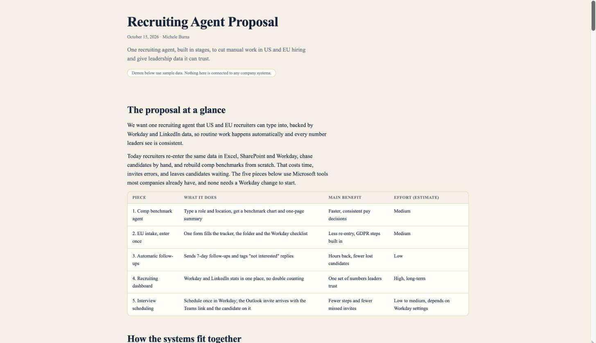
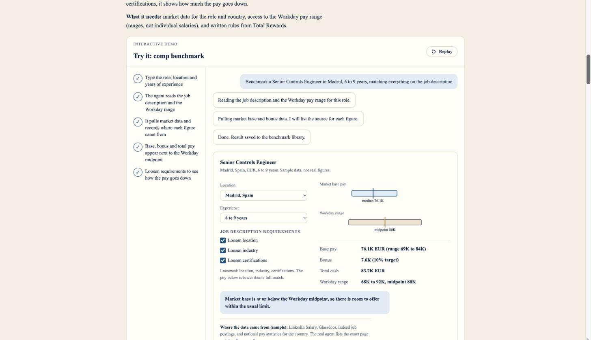
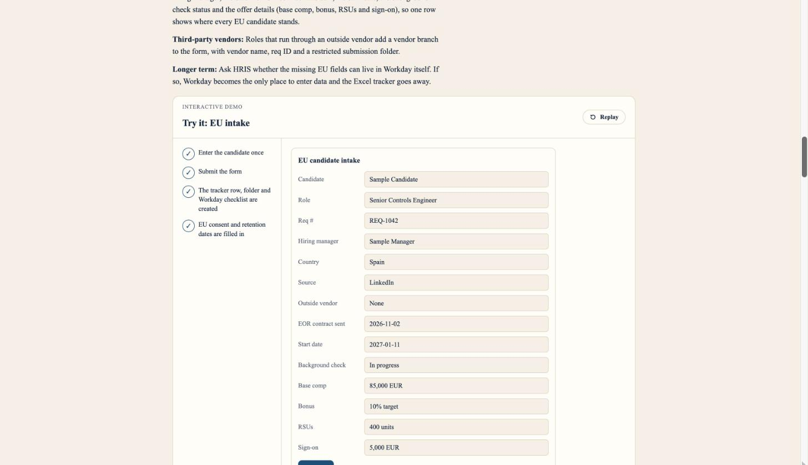

# Recruiting Agent Proposal

A single-page proposal for a recruiting agent that cuts manual work in US and EU hiring and gives leadership one consistent set of numbers.

Prepared by Michele Burns, October 2026.

Live page: https://micheleburns74-prog.github.io/recruiting-agent-proposal/

## Preview

## What the proposal covers

1. **Comp benchmark agent.** Type a role and location and get a benchmark chart and one-page summary, with the internal salary midpoint shown next to market pay.
2. **EU intake, enter once.** One short form creates the tracker row, the shared folder and the HRIS checklist, with EU consent and retention dates built in.
3. **Automatic follow-ups and reply handling.** A follow-up goes out after 7 days of silence, and "not interested" replies are tagged and stop further emails.
4. **Recruiting dashboard (long-term).** HRIS and LinkedIn stats in one place, with each candidate counted once.
5. **Interview scheduling in one step.** Schedule once in the HRIS and the calendar invite arrives with the video link and the candidate on it.

The page also includes expected results, a phased rollout and a table of questions to answer before building.

## What is in this repository

- `index.html`: the full proposal as one self-contained web page. No build step.
- `README.md`: this file.

## Notes

All demos use sample data. Nothing on the page is connected to any company's systems, and it contains no real company or candidate information.
